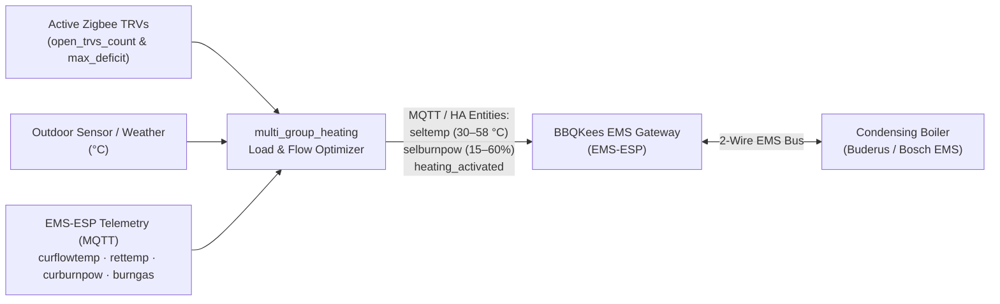

# Multi-Group TRV Schedule & Load-Aware Boiler Demand Controller (`multi_group_heating`)

A standalone **Home Assistant Custom Integration** (for the Home Assistant Marketplace / HACS) that implements a battle-tested **3-tier smart heating & condensing-boiler controller**:

1. **Tier 1 — Schedule & Mode Manager**: Native `select` (`Away`, `Comfort`, `Day`, `Night`), 4 configurable daily `time` transition entities (`Morning Comfort`, `Day`, `Evening Comfort`, `Night`), and 20 `number` preset entities across **5 heating groups** (with automatic `Away` lockout).
2. **Tier 2 — Paced Zigbee Group Binding, Manual Overrides & Self-Healing**: 5 virtual group target `number` entities (`TS Target <Group>`) that propagate setpoints **one active (`heat`) TRV at a time (`2s` default pacing)** so sleepy-Zigbee parent routers never overflow their indirect buffers, verify physical `Eco` valve response after `10s` (defeating ZHA optimistic setpoint caching), sync `off → heat` wakeups automatically, and preserve manual per-thermostat overrides until the next schedule boundary.
3. **Tier 3 — Two-Stage Load-Aware Boiler Demand Controller & Physical Relay ACK**: Eliminates condensing-boiler short-cycling using a configurable **Stage 1 Anti-Cycle Cooldown (`20 min` default)** + **Stage 2 Single-TRV Partner Wait (`12 min` default)** that batches solo shallow calls in mild weather while firing **immediately** on `2+` open TRVs, cold outdoor weather (`≤ 3.0 °C`), deep room deficit (`≥ 0.7 °C`), or any user/Comfort intent—backed by physical relay `hvac_action` ACK retries (`10s` / `20s`) and a `60s` watchdog.

---

## Key Features in v2.0

### 1. Manual Per-Thermostat Override (Persists Until Next Cycle)
> [!TIP]
> **Manually adjusting any individual thermostat (via the Home Assistant UI or by turning the physical TRV knob) immediately overrides the schedule for that specific radiator—and stays in effect until the next scheduled transition.**

- **Single-Element Override**: Changing `TS_Dorm1` manually affects **only `TS_Dorm1`**. Sibling TRVs in the same group keep their scheduled setpoint, and radiators intentionally set to `off` are never forced back `on` by group updates.
- **Instant Boiler Response**: Raising a virtual group target, raising an individual TRV setpoint, switching a TRV `off → heat`, or entering `Comfort` mode **immediately cancels** any active anti-cycle cooldown or partner-wait hold so the boiler fires without delay.
- **Clean Reset at Mode Boundaries**: Manual overrides are never overwritten by periodic polling, and are cleanly reset at the next scheduled transition—even when two consecutive modes share the same preset temperature.

### 2. Two-Stage Condensing Boiler Anti-Short-Cycle & Load Batching
Condensing gas boilers typically have a `3.0–3.5 kW` minimum modulation floor, whereas a single panel radiator dissipates `~1.0–1.5 kW` at condensing flow temperatures. Firing the boiler for one shallow radiator call causes rapid burner sub-cycling:

- **Stage 1 — Anti-Cycle Cooldown (`number.*_boiler_min_off_minutes`, default `20 min`)**: When all TRVs close and the boiler stops, a cooldown window holds passive cooling calls (leaving calling TRVs open at `100%`) so staggered rooms synchronize into a single multi-radiator condensing run.
- **Stage 2 — Single-TRV Partner Wait (`number.*_boiler_single_trv_wait_minutes`, default `12 min`)**: When cooldown is idle in mild weather (`> 3.0 °C`) and only **1 passive TRV** opens at a shallow deficit (`0.5–0.6 °C`), the controller waits up to `12 min` so a second radiator can join the run. It starts **immediately** as soon as:
  - **`2+` TRVs** call simultaneously (`multi_trv`),
  - **Outdoor temperature `≤ 3.0 °C`** (`cold_weather`),
  - Any calling room cools **`≥ 0.7 °C` below target** (`deep_deficit`),
  - The partner-wait timer finishes, or
  - Any **user/Comfort override** occurs (or the 1-tap bypass `button` is pressed).
- Once firing, the boiler stays latched **ON** until **all** open TRVs reach target (`0%`).

### 3. Sleepy-Zigbee Hardening (Tuya `TS0601` / ZHA & Zigbee2MQTT)
> [!IMPORTANT]
> For Tuya/Moes `TS0601` (`_TZE204_ltwbm23f`) Zigbee TRVs, set each valve's **`Hysteresis mode` (`select.*_hysteresis_mode`) to `Eco`** (not `Comfort`) and **`Motor thrust` to `Strong`**:
> - **`Comfort`** uses a sluggish proportional curve that opens the valve only **`1%–7%`** at `0.5–1.0 °C` deficit, starving the radiator while the boiler burns gas.
> - **`Eco`** acts as a crisp **`0.5 °C` hardware hysteresis switch** (`0% / idle` until `Setpoint − 0.5 °C`, then **`100% / heating`** until target is reached, then `0% / idle`).

Built-in Zigbee mitigations:
- **Sequential `2s` Per-TRV Pacing**: Sends `climate.set_temperature` (`temperature` only, omitting `hvac_mode` to avoid the Tuya `20.0 °C` firmware reset bounce) one TRV at a time so Zigbee parent routers (`TS011F` smart plugs, wall relays) never drop indirect-transmission frames.
- **Physical `Eco` Valve Verification (`10s`)**: ZHA's Tuya MCU quirk optimistically updates `temperature` in Home Assistant within `10–40 ms` even if the RF packet was dropped. After `10s`, the controller verifies both the setpoint attribute **and** physical `hvac_action` consistency against the `Eco` deadband, retrying automatically if mismatched.
- **Rogue-Heating Self-Healing**: If a passive setpoint drop was missed while a TRV was asleep and `idle`, the moment that TRV later wakes up and enters `heating` while `current_temperature ≥ temperature`, the controller immediately re-pushes the setpoint while its radio is awake.
- **Physical Boiler Relay ACK & Watchdog**: Checks both `climate.<boiler>` state and physical `hvac_action` (`sensor.<boiler>_hvac_action` / `hvac_action` attribute) with `10s` + `20s` retries and a `60s` watchdog so dropped Zigbee relay packets (`SONOFF TP-WGZBA`, etc.) never leave the boiler stuck on or off.

---

## Installation via Home Assistant Marketplace (HACS)

1. Open **HACS** in Home Assistant → **3-dots menu (top right) → Custom repositories**.
2. Add `https://github.com/cpetra/ha-multi-group-heating` with Category: **Integration**.
3. Download **Multi-Group Boiler Heating** and restart Home Assistant.
4. Go to **Settings → Devices & Services → Add Integration → Multi-Group Boiler Heating** and configure:
   - **Boiler Thermostat Entity** (`climate.*`) & **Boiler Firing Setpoint** (default `25.0 °C`)
   - **Outdoor Temperature Sensor or Weather Entity** *(optional, enables cold-weather immediate start `≤ 3.0 °C`)*
   - **Cold Weather Threshold** (`3.0 °C`) & **Urgent Deficit Threshold** (`0.7 °C`)
   - **Per-TRV Zigbee Pacing Delay** (`2 s`) & **Physical Verification Delay** (`10 s`)
   - Up to **5 Heating Groups** (Name + assigned TRV `climate.*` entities)

---

## Entities Created Automatically

All entities belong to a single **Multi-Group Heating** service device and persist state across Home Assistant restarts (`RestoreEntity`):

| Platform | Entities Created | Purpose |
|---|---|---|
| `select` | `select.*_heating_mode` | Active schedule mode (`Away`, `Comfort`, `Day`, `Night`) |
| `time` (×4) | `time.*_morning_comfort_start`, `day_mode_start`, `evening_comfort_start`, `night_mode_start` | Daily transition times (bypassed automatically while `Away` is active) |
| `number` (×5) | `number.*_ts_target_<group>` | Virtual group target temperature (`5.0–30.0 °C`) |
| `number` (×20) | `number.*_<mode>_temp_<group>` | Per-group preset temperatures for `Comfort`, `Day`, `Night`, `Away` |
| `number` (×2) | `number.*_boiler_anti_cycle_cooldown`, `boiler_single_trv_wait` | Runtime-tunable Stage 1 cooldown (`0–30 min`, default `20`) & Stage 2 partner wait (`0–30 min`, default `12`) |
| `sensor` | `sensor.*_heating_demand_action` | Raw valve demand (`start`, `stop`) + full diagnostic attributes |
| `sensor` | `sensor.*_open_trvs_count` | Count (`TRVs`) of active radiators currently open (`hvac_action == heating`) |
| `sensor` | `sensor.*_boiler_controller_state` | Live two-stage state (`idle`, `cooldown_hold`, `partner_wait_hold`, `heating`) |
| `binary_sensor` | `binary_sensor.*_urgent_heating_demand` | `on` when `2+` TRVs call, outdoor temp `≤ 3.0 °C`, deficit `≥ 0.7 °C`, or partner wait is `0` |
| `button` (×2) | `button.*_cancel_anti_cycle_cooldown`, `start_single_trv_heating_now` | 1-tap manual override buttons for dashboard cards |

---

## Roadmap: BBQKees EMS Gateway Integration (`EMS-ESP` Bus Modulation)

We are integrating a **BBQKees EMS Gateway** (running **`EMS-ESP`** firmware over **MQTT Discovery**) connected directly to the boiler's **EMS / EMS Plus bus** (tested target: **Buderus Logamax plus GB122-24 KD H**, `3.0–3.4 kW` min / `24.0 kW` max CH, `1:10` modulation; compatible with Bosch, Buderus, Nefit, Junkers, and Worcester EMS boilers).

### How EMS-ESP Upgrades Tier 3 (From On/Off Relay to Digital Bus Modulation)

Currently, Tier 3 drives a dry-contact room-thermostat relay (`climate.*`, e.g., `SONOFF TP-WGZBA`) while the boiler uses a fixed manual flow temperature (`48 °C`) and static max CH power (`50%`). Adding the **BBQKees EMS Gateway** unlocks direct digital bus control and real-time burner telemetry:



1. **Dynamic Load- & Weather-Compensated Flow Setpoint (`number.boiler_selected_flow_temperature` / `seltemp`)**:
   - Replaces fixed panel flow temperature with a continuous target (`30 °C – 58 °C`, or `0 °C` when idle) computed from:
     - **Outdoor Weather Reset Curve**: Base supply temperature scaled inversely with outdoor temperature.
     - **Active Radiator Load (`open_trvs_count`)**: Low supply temperature (`35–42 °C`) when 1–2 TRVs are open so small loads dissipate steadily without tripping burner high-limit shutoffs; higher supply temperature (`45–55 °C`) when `4+` radiators call simultaneously.
     - **Room Deficit Boost (`max_calling_deficit`)**: Proportional boost during morning `Comfort` recovery (`ΔT ≥ 1.0 °C`), tapering down smoothly as rooms approach target.
2. **Return-Temperature Condensing Guard (`< 54 °C` Flue Dew Point)**:
   - Monitors live **`sensor.boiler_current_flow_temperature` (`curflowtemp`)** and **`sensor.boiler_return_temperature` (`rettemp`)** (`ΔT = T_flow − T_return`).
   - Automatically trims flow temperature and pump/burner ceiling if `T_return` approaches **`50–54 °C`**, keeping the heat exchanger firmly in the latent-heat condensing regime (`108–109%` Hi efficiency) even when radiators warm up.
3. **Dynamic Burner Power Ceiling (`number.boiler_heating_max_power` / `selburnpow`)**:
   - Dynamically scales maximum central-heating burner power (`15%–60%`) according to `open_trvs_count` so ignition ramps never overshoot flow temperature on small 1–2 radiator loads before the burner settles to minimum modulation (`~12–14%` / `3.0–3.4 kW`).
4. **Native EMS Bus Telemetry & Diagnostics (Replacing Relay Estimation)**:
   - Direct hardware truth via MQTT entities:
     - `binary_sensor.boiler_burner_active` (`burngas`) & `sensor.boiler_current_burn_power` (`curburnpow`, `%`)
     - `sensor.boiler_current_flow_temperature` (`curflowtemp`, `°C`) & `sensor.boiler_return_temperature` (`rettemp`, `°C`)
     - `sensor.boiler_pump_modulation` (`pumpmod`, `%`) & `sensor.boiler_system_pressure` (`syspress`, `bar`)
     - `sensor.boiler_burner_starts` (`burnstarts`) & `sensor.boiler_burner_work_time` (`burnworkmin`) — exact hardware cycle counts and burner hours, plus low-water-pressure (`< 1.0 bar`) and fault-code (`servicecode` / `servicecodenumber`) alerts.
5. **Wiring Coexistence & Fail-Safe Relay Fallback**:
   - **EMS Bus Connection**: Connects via the boiler's `3.5 mm` service jack (bus-powered) or internal 2-wire EMS terminals alongside Mosquitto MQTT in Home Assistant (`EMS-ESP` *Boiler Write* access enabled).
   - **Dry-Contact Terminal Handling**: To let EMS-ESP modulate CH demand via `heating_activated` / `seltemp`, the legacy on/off room-thermostat contact (`climate.centrala`) is kept closed (`heat @ 25 °C` or bridged)—and retained by `multi_group_heating` as an **automatic hardware fail-safe fallback** that reverts to binary `start`/`stop` relay switching if the EMS-ESP Wi-Fi/MQTT gateway ever becomes `unavailable`.

---

## Repository Structure

```text
ha-multi-group-heating/
├── .github/
│   └── workflows/
│       └── validate.yaml                     # GitHub Actions: hassfest + HACS validation
├── custom_components/
│   └── multi_group_heating/
│       ├── __init__.py                       # Integration setup, lifecycle & unload
│       ├── binary_sensor.py                  # Urgent Heating Demand binary sensor
│       ├── button.py                         # Cooldown & Partner-Wait bypass buttons
│       ├── config_flow.py                    # UI Config Flow & Options Flow
│       ├── const.py                          # Domain constants & defaults
│       ├── coordinator.py                    # 3-Tier paced Zigbee & two-stage boiler controller
│       ├── manifest.json                     # Home Assistant integration manifest (v2.0.0)
│       ├── number.py                         # 5 Virtual Targets + 20 Presets + 2 Batching timers
│       ├── select.py                         # Heating Mode selector (Away, Comfort, Day, Night)
│       ├── sensor.py                         # Demand Action, Open TRVs Count & Controller State
│       ├── strings.json                      # UI strings
│       ├── time.py                           # 4 Daily schedule transition time entities
│       └── translations/
│           └── en.json                       # English UI translations
├── .gitignore
├── hacs.json                                 # Marketplace metadata
├── LICENSE                                   # MIT License
└── README.md
```
